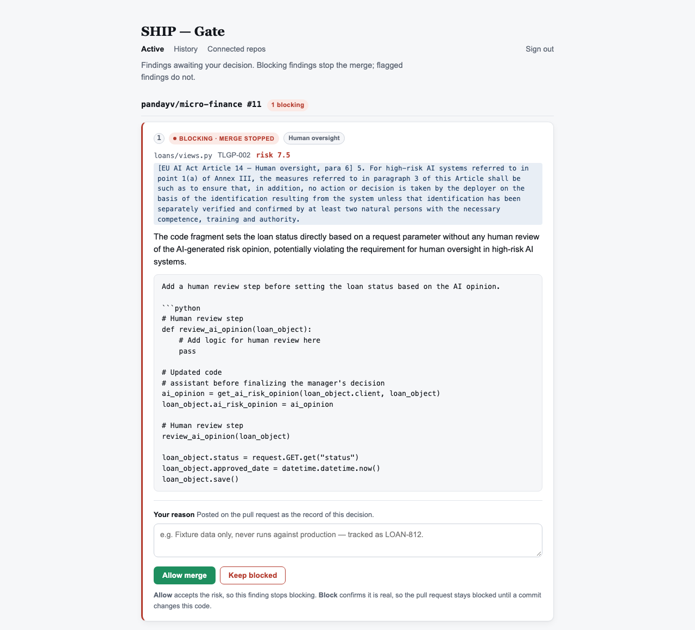

# SHIP

Fast-moving teams shipping Gen AI features routinely introduce compliance hazards without meaning to: unmasked personal data (an SSN, a zip code) sitting in a prompt, race or gender quietly swaying a credit decision, an AI decision loop running with no one watching it.

These hazards hurt the people affected, and risk penalties under GDPR and the EU AI Act.

A small team can't afford a dedicated compliance hire, and reviewing every PR by hand would grind feature velocity to a crawl.

SHIP closes that gap: it catches AI compliance risk before it ships, without slowing the team down.

**SHIP is a multi-agentic gatekeeper that reads every pull request the moment it opens, catches the ones that quietly cross a legal line, and interacts with you only when it's found something.**

Ask it anytime through Alexa+. It answers in one sentence, and shows the full detail on your nearest screen.

Built for [Build, Ship, Shape: the Amazon Developer Hackathon](https://amazonappdev2026.devpost.com/) (Alexa+ track, AWS Builder mini-challenge).



---

## What it does

SHIP is five pieces working as one pipeline, each named for its job:
Screener, Detector, Triage, Gate, Relay.

1. **A PR opens, and Screener checks it first.** A free regex/AST scan
   runs on every commit. Nothing matches, the PR passes in
   milliseconds, no model call spent.
2. **If something matches, Detector takes a closer look.** It reviews
   just that fragment, grounded against sourced regulation text, not
   memory, and returns a verdict: risk score, plain-English explanation,
   citation, and a draft fix. It also learns from Gate's own past
   decisions over time.
3. **If Detector confirms a real violation, Triage blocks the merge.**
   The PR's own commit status turns red, which is what actually stops
   the merge button, not just a dashboard entry.
4. **A human resolves it in Gate**, the review console: file, risk,
   explanation, citation, suggested fix, one click to approve or
   reject. The decision posts back to the PR and clears the block.
5. **Relay carries that same review to voice and screen**, so it comes
   to you wherever you are, instead of you having to go find it in Gate.

SHIP watches for four kinds of risk: exposing sensitive personal data,
decisions made with no human review, bias from a protected trait, and
AI handed more authority than it should have. Backed by six detectors
tied to real law, full detail in
[architecture.html](https://pandayv.github.io/ship-engine/architecture.html).

## How to see it in action

Three ways to try this.

1. **Experience it live.** Judges: instructions for adding a test PR
   and trying it live are included in the submission materials.
2. **Watch the demo video.** *(Video link goes here before final
   submission.)*
3. **Set it up yourself.** Full steps in [SETUP.md](SETUP.md).

### Integrated Alexa+ experience

SHIP is built as an Alexa+ experience. It works in the background and
speaks up only when something needs you. Your Echo chimes, you ask what's
up, and the detail appears on the screen you choose.

Alexa+ add-ons aren't open to hackathon participants, so an Alexa Skill
stands in for the add-on. The hackathon
[FAQ](https://amazonappdev2026.devpost.com/details/faqs) says the add-on
tools are for select partners only, and the documented route to them stops
at an AWS role that only accounts registered by an Amazon Alexa Solutions
Architect can assume (see the [friction log](FRICTION_LOG.md)). The skill
calls the same MCP server an add-on would.

You don't need special phrases. Say it the way you'd say it to a colleague.

**1. Meets you where you are**
Findings aren't read aloud in a long monologue. Instead, anything that needs your review shows up on your nearest screen: a phone, a tablet, a laptop, a TV, even a smart fridge.

> *"Alexa, what's up?"*
> **"2 blockers found. Ready for your decision. Want it on a screen?"**
> *"Show me on the TV."*

The actual findings then appear, live, on whatever screen just answered
to that screen/device name.

To set a screen up, open the
[display page](https://pandayv.github.io/ship-engine/ship-display.html) on the
device and pick a name: TV, Tablet, Laptop or Fridge. SHIP only offers screens
that are set up. With none, it says so and puts a link to the review console
in your Alexa app.

**2. Voice can confirm a decision. It can never make one blind.** Ask to
approve a finding you've never looked at, and SHIP refuses. That's the
exact pattern SHIP is designed to flag in *other* people's code: an AI-mediated decision applied with no human checkpoint. Try it:

> *"Approve it."*
> **"Take a look on a screen first, then tell me why. Opening it on your screen."**

Look at it first, then say what you decide and why. SHIP puts what it
understood on your screen and waits for you to confirm:

> *"Approve the first one because it's a false positive."*
> **"Got it, take a look and say proceed when you're ready."**
> *"Yes, go ahead."*
> **"Done."**

The server enforces this rule, not the model. Voice can only act on a
finding you've just seen on a screen, a reason is always required, and
nothing happens until you confirm.

### What you can say

Say it the way you'd say it to a colleague. A few examples:

| You want to | You can say |
|---|---|
| Know where things stand | "What's up?" "Is anything blocking us from shipping today?" "How many blockers do we have?" |
| See the detail | "Show it on the laptop." "Put the problems up on my tablet." "I want to see them on the TV." |
| Decide | "Approve the first one on pull request 5 because it's only test data." "Reject the second one, it really does leak a phone number." "The first two on pull request 1 are false positives because they're test fixtures." |
| Confirm or back out | "Yes, go ahead." "No, never mind." |
| Get alerted | "Turn on alerts." (Alexa then sends a permission request to your Alexa app.) |

SHIP asks when something is missing, such as "What's the reason?" or "Which
screen?", and says no when a rule says no.

No Echo? **[Try the simulator](https://pandayv.github.io/ship-engine/alexa-simulator.html)**,
a web page that talks to the same Relay server as the skill.

## How it's built

### Guiding principles

**1. Last line of defense.**
Assume nothing was checked before this. It doesn't matter who wrote the
code, a person or an AI. It doesn't matter if the feature uses AI or not.

**2. Grounded, not guessed.**
Rely on facts, not memory or guesswork. Keep improving to make that
grounding sharper.

**3. Meet you where you are.**
The answer finds you, on whatever device is nearest, not the other way
around. Ask by voice from anywhere. See the detail on whatever screen is
closest, a laptop, a TV, even a fridge.

**4. Scalability and resilience.**
Survive retries, failures, and heavy load without breaking.

**5. Cost efficiency.**
Free deterministic checks first, LLM only when needed. Only the right
model for the job, measured.


### Architecture

Full diagram and component-by-component detail: [pandayv.github.io/ship-engine](https://pandayv.github.io/ship-engine/architecture.html) ([source](docs/architecture.html)).

The one piece worth calling out here: **each flagged issue in a PR is
reviewed as its own independent, retryable job**, queued and picked up by
an independently-scaling reviewer function, rather than one sequential
pass through the whole PR. A fragment that fails outright retries
automatically and lands in a dead-letter queue after repeated failure
instead of vanishing. A fragment that's just slow, or that hits AWS's own
request-rate limit, backs off and retries on its own without blocking
anything else. A PR with several flagged issues takes about as long as
its slowest single issue, not the sum of all of them, and nothing is
silently dropped.

### Tech stack

- **Agent framework:** [Strands Agents SDK](https://github.com/strands-agents/sdk-python)
- **Models:** Amazon Nova Lite as the primary Bedrock backend, chosen on
  measured evidence rather than preference. Benchmarked against Claude
  Haiku 4.5, Nova Pro, Qwen3-235B, GLM-5, and DeepSeek-V3.2 on the real
  adversarial fixtures below: all six caught every genuine violation and
  dismissed every look-alike, but per-model request-per-minute quota is
  what actually bounds review throughput on this account (10/min for
  Claude models vs. 200/min for Nova Lite). See the benchmark table in
  [`src/agents/detector.py`](src/agents/detector.py). Google Gemini serves
  as a credit-exhaustion fallback and a local Ollama model as a fully
  offline reliability fallback. Both are switchable via one env var.
- **Agent runtime:** Amazon Bedrock AgentCore Runtime, the same Detector
  logic deployed to a real managed runtime ([`shipagentcore/`](shipagentcore/)),
  callable in-process for local development or remotely for the deployed
  path, toggled the same way
- **Retrieval:** Amazon Bedrock Titan Embeddings, a small local
  numpy cosine-similarity store (the sourced regulation corpus is a
  few dozen chunks, so a hosted vector database would be pure overhead
  at this scale)
- **Compute:** two AWS Lambda functions, the webhook (fast-ack: verify,
  screen, dispatch) and an independently-scaling fragment processor
  (the actual model call, one fragment per invocation)
- **Queueing:** Amazon SQS, with a dead-letter queue for fragments that
  fail repeatedly and a concurrency cap on the processor so parallel
  reviews stay within the account's real request-rate limit
- **State:** Amazon DynamoDB, one table per access pattern. `ship-alerts` (every write
  idempotent, so a webhook redelivery or a retried job can't create a
  duplicate and can't silently re-open a decision a human already made),
  `ship-repos` (which repositories SHIP watches, plus when each last sent
  an event and when one last finished review. The gap between the two,
  surfaced on Gate's connected-repos view, is what a silently broken
  pipeline looks like before anyone needs to notice by accident, see
  `src/storage/repo_store.py`), `ship-status` (a precomputed release
  summary, so Relay's voice path is one `GetItem` regardless of how many
  findings exist, since Alexa+ allows Relay half a second to answer and
  aggregating on read would have blown that budget as findings
  accumulate), `ship-device-connections` (which device is reachable under
  which name, for the push path below), `ship-recent-reviews` (which
  alert was shown on a screen and when, the ten-minute window
  `request_risk_acceptance` checks before acting on a spoken
  confirmation), `ship-pending-dispositions` (decisions staged by voice,
  held until an explicit "proceed" writes them to `ship-alerts`), and
  `ship-learned-patterns` (the generalized patterns above)
- **Web:** FastAPI (the webhook route and the Gate console, one
  deployable app, wrapped for Lambda via Mangum)
- **Voice/MCP:** [MCP Python SDK](https://github.com/modelcontextprotocol/python-sdk)
  (Streamable HTTP, spec `2025-11-25`) powers Relay
  ([`src/relay/`](src/relay/)), deployed as its own Lambda with
  [SnapStart](https://docs.aws.amazon.com/lambda/latest/dg/snapstart.html)
  enabled. A fresh ASGI app is built per invocation, a genuine SDK/Lambda
  incompatibility rather than a style choice. The docstring at the
  top of [`src/relay/server.py`](src/relay/server.py) has the details.
- **Voice:** an Alexa Skill ([`alexa-skill/`](alexa-skill/)) stands in for an
  Alexa+ add-on. Alexa does the speech. Common requests are answered by plain
  code; anything said in the person's own words goes to Amazon Nova Lite on
  Bedrock, which picks the Relay tools to call. The model proposes and plain
  code decides: it can only reach four tools, a screen must have been named,
  a decision needs a reason in the person's own words, and what is spoken back
  is Relay's own sentence.
- **Push:** an Amazon API Gateway WebSocket API plus a small dedicated
  Lambda ([`device_gateway_handler.py`](device_gateway_handler.py))
  handling connect/disconnect/register, deliberately separate from Relay
  so Relay's own IAM role stays scoped to exactly what answering a
  question requires. A display sits idle with no polling until Relay
  pushes a finding to it; a real compliance event happens on the order
  of weeks, not seconds, so a poll-every-few-seconds design would spend
  nearly all its traffic finding nothing changed

## Setup

Deploying this yourself needs a real AWS account (Bedrock, Lambda,
DynamoDB, SQS, API Gateway) and about 30–45 minutes, less with
[`deploy.sh`](deploy.sh), which scripts most of it. Full step-by-step
walkthrough, including troubleshooting for a brand-new AWS account:
[SETUP.md](SETUP.md).

## Project structure

```
src/
  agents/
    screener.py        # Fast regex/AST pre-filter + per-fragment isolation
    detector.py         # Strands Agent — RAG-grounded semantic judgment
    triage.py           # Risk-based routing, per-category thresholds
  api/
    main.py             # Webhook route, fast-ack + fragment dispatch
    dashboard.py         # Gate — the human review console
    alexa_notify.py      # Sends the Echo notification when a finding is recorded
    github_client.py    # Real PR-diff fetching via the GitHub API
    github_writeback.py # Posts findings/decisions back to the PR (comment + commit status)
  aws/
    bedrock_session.py  # Shared Bedrock session + adaptive-retry config
  rag/
    chunker.py           # Regulation text -> citable paragraph chunks
    vector_store.py      # Local embedding store + retrieval
  storage/
    alert_store.py       # DynamoDB — idempotent alert persistence
    repo_store.py         # DynamoDB — which repos SHIP watches
    status_store.py       # DynamoDB — precomputed release summary Relay's voice path reads
    device_store.py        # DynamoDB — which display device is reachable under which name
    alexa_user_store.py    # DynamoDB — which Alexa users SHIP may notify
  taxonomy.py            # Single source of truth: detector <-> corpus <-> Screener trigger mapping
  relay/
    server.py             # Relay — the MCP server; the voice/screen modality split lives here
    modality.py            # Enforces the spoken-response character cap and forbids line breaks
    readmodel.py           # Voice path (reads the precomputed summary) vs. screen path (reads alerts)
    push.py                 # Delivers a payload to one named device over its open connection
alexa-skill/
  lambda/lambda_function.py  # The Alexa Skill: turns what Alexa hears into calls to Relay over MCP
  skill-package/             # Skill manifest and language model
rag_corpus/               # Sourced regulation/standard text, verbatim
shipagentcore/             # AgentCore Runtime deployment of Detector
docs/
  alexa-simulator.html     # Web simulator of the Alexa+ flow; an MCP client of the deployed Relay
  ship-mcp-client.js        # The MCP client the simulator uses: initialize, tools/list, tools/call
  ship-display.html         # Any-device receiving surface — names itself, waits for a push
  ship-render.js            # Finding-rendering logic shared by both pages above
  architecture.html          # Full pipeline diagram
scripts/
  healing_loop.py          # Periodic corpus-grounding check, decoupled from the hot path
  benchmark_models.py      # The adversarial benchmark behind the Nova Lite model choice
  precompute_embeddings.py # Regenerates rag_corpus/'s cached embeddings
lambda_handler.py          # Webhook Lambda entrypoint
fragment_lambda_handler.py # Fragment-processor Lambda entrypoint
relay_lambda_handler.py    # Relay's Lambda entrypoint — builds a fresh app per invocation, see server.py
device_gateway_handler.py  # WebSocket connect/disconnect/register Lambda entrypoint
tests/                     # Test suite, no AWS credentials required to run
```

## Status & what's next

The full review pipeline, Screener through Gate, is live and deployed.
The PR's own merge button is gated by a commit status, not a dashboard
entry someone has to remember to check. Freezing an alert sets
`ship/compliance` to failing (promotable to a required check in branch
protection); resolving one recomputes it, closing the loop from detection
to a human decision to the merge button itself.

Relay (the MCP server), the Alexa Skill, the web simulator, and cross-device
push are also live. The
[Integrated Alexa+ experience](#integrated-alexa-experience)
section above walks through it.

What's not built yet:
- **Auto-applying the suggested fix.** Approving an alert doesn't push
  the patch to the PR yet; a human applies it after reviewing it in
  Gate. A GitHub-API integration away, not an architecture change.
- **Scheduling the Healing Loop.** [Healing Loop](scripts/healing_loop.py)
  re-checks that sourced regulation text still matches the law, catching
  anything a regulator has since amended. It runs today as a manual
  script, not yet on a schedule or alert channel.
- **A real Alexa+ add-on.** Add-on tooling is limited to select partners
  today. When it opens, the add-on points at the same Relay server and the
  skill steps aside.
- **Detectors that need more than a single PR diff.** Infrastructure or
  deployment context, or behavior observed across multiple files or over
  time. See [architecture.html](https://pandayv.github.io/ship-engine/architecture.html)
  for where that boundary sits.

## License

MIT. See [`LICENSE`](LICENSE).
