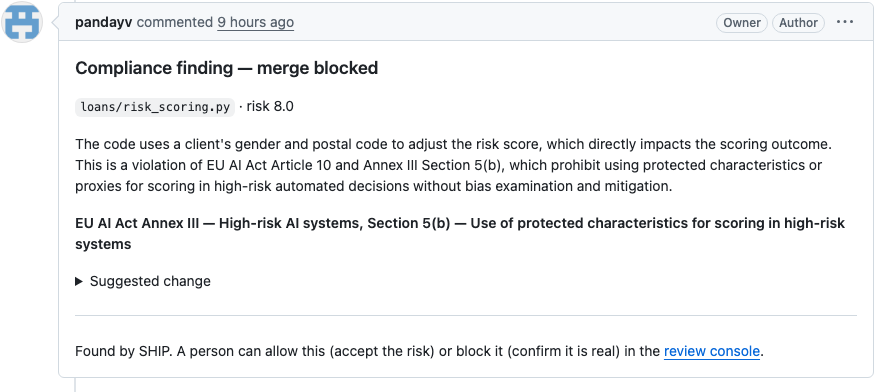
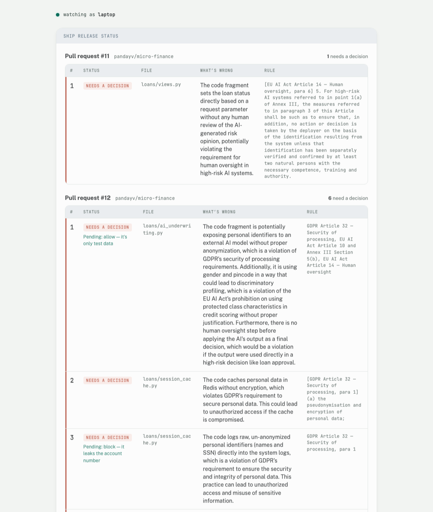

# SHIP

Fast-moving teams shipping Gen AI features routinely introduce compliance hazards without meaning to: unmasked personal data (an SSN, a zip code) sitting in a prompt, race or gender quietly swaying a credit decision, an AI decision loop running with no one watching it.

These hazards hurt the people affected, and risk penalties under GDPR and the EU AI Act.

A small team can't afford a dedicated compliance hire, and reviewing every PR by hand would grind feature velocity to a crawl.

SHIP closes that gap: it catches AI compliance risk before it ships, without slowing the team down.

**SHIP is a multi-agentic gatekeeper that reads every pull request the moment it opens, catches the ones that quietly cross a legal line, and interacts with you only when it's found something.**

Ask it by voice anytime. It answers in one sentence, shows the full detail on the screen you choose, then walks you through the findings one question at a time. You answer in plain words.

Built for [Build, Ship, Shape: the Amazon Developer Hackathon](https://amazonappdev2026.devpost.com/) (Alexa+ track, AWS Builder mini-challenge).


---

## Guiding principles

**A person decides.**
SHIP finds, explains and proposes. Only a person who has looked at the evidence decides, and the reason goes on the record.

**Last line of defense.**
Assume nothing was checked before this. It doesn't matter who wrote the code, a person or an AI.

**Grounded, not guessed.**
Rely on facts, not memory or guesswork. Every citation traces to sourced regulation text.

**Meet you where you are.**
The answer finds you, on whatever device is nearest. Voice gives the headline and asks the questions. A screen gives the detail. You never need to know the right phrase.

**Learns from your decisions.**
What reviewers allow shapes the next review. Detector still judges every finding against the regulation text.

**Honest when unsure.**
A status SHIP can't read is never called all clear. A review that hasn't finished never shows a green check.

**Scalability and resilience.**
Survive retries, failures and heavy load without breaking.

**Cost efficiency.**
Free deterministic checks first, a model only when needed.

## The pipeline

SHIP is five pieces working as one pipeline, each named for its job:
Screener, Detector, Triage, Gate, Relay.

1. **A PR opens, and Screener checks it first.** A free regex/AST scan
   runs on every commit. If nothing matches, the PR passes in
   milliseconds and no model call is spent.
2. **If something matches, Detector takes a closer look.** It reviews
   just that fragment, grounded against sourced regulation text, and
   returns a verdict: risk score, plain-English explanation, citation,
   and a draft fix.
3. **Triage routes the verdict.** A finding above the line blocks the
   merge: the PR's own commit status turns red, and as a required check
   in branch protection that stops the merge button. A finding below the
   line is flagged for a human without blocking.
4. **A person decides in Gate**, the review console, or by voice. They
   see file, risk, explanation, citation and suggested fix, then
   allow or block.
5. **Relay carries the same review to voice and screen**, so it comes
   to you wherever you are.

A person makes one of two calls. **Allow** means you accept the risk. The
finding stops blocking, and the pull request can merge once nothing else
blocks it. **Block** means the finding is real. The pull request stays
blocked until a later commit changes the flagged code. Either way, your
decision and your reason are posted to the PR. In Gate, a blocking finding
offers "Allow merge" and "Keep blocked".



SHIP watches for four kinds of risk: exposing sensitive personal data,
decisions made with no human review, bias from a protected trait, and
AI handed more authority than it should have. The detectors are grounded
in GDPR, the EU AI Act and OWASP, and are listed in
[architecture.html](https://pandayv.github.io/ship-engine/architecture.html).

## What it feels like

### By voice

Voice works best as a conversation. SHIP asks one short question at a
time, and you answer the way you would answer a colleague.

When SHIP records a new finding, your Echo gets a notification from SHIP
("You have 2 new unread messages from SHIP"). Nothing is read out until
you ask.

> *"Alexa, ask ship review what's up."*
>
> **"2 blockers found. Ready for your decision. Want it on the laptop or the tablet?"**
>
> *"The laptop."*
>
> **"Putting it on your laptop. Want to go through them?"**
>
> *"Yes."*
>
> **"Pull request 1 has 2 findings on your screen. Number 1 on pull request 1. Allow, block, or skip?"**
>
> *"Allow it, it's only test data."*
>
> **"Got it. Number 2 on pull request 1. Allow, block, or skip?"**
>
> *"Block."*
>
> **"What's the reason? For example, it exposes personal data, or it needs a fix."**
>
> *"It leaks a phone number."*
>
> **"Got it. That's all for pull request 1: 1 allowed, 1 blocked. Say yes to apply."**
>
> *"Yes."*
>
> **"Done. Applied all 2. That's everything you've looked at."**

The findings appear on the laptop. SHIP offers only the screens that
exist. With one screen it asks "Want it on the laptop?", and a plain yes
is enough. With none it says so and puts a link to the review console in
your Alexa app. Name the screen in your own words ("the tablet please")
or say "both".

The walk-through covers only the findings you have looked at on a screen.
For each one SHIP asks what to do. Put the reason in the same breath if
you like, or let SHIP ask for it. Every decision is staged as soon as you
make it, and the screen shows it as pending. At the end of a pull request
SHIP says what you decided and waits for your yes. Only that yes applies
the batch. Then it offers the next pull request.

You can steer at any point. Say skip or next to leave a finding for later,
go back or undo to take the last decision off, repeat to hear the question
again, help for the options, or stop. If you stop after deciding some
findings, SHIP asks whether to apply them or drop them. Point at a finding
by its number ("number 3, block it"), or decide the rest of a pull request
at once ("allow all of them because they are test fixtures").

If the screen's page was closed, SHIP sends a notification instead. It
waits for you to say "ready", then asks Relay whether the findings were
displayed before it starts.

If SHIP can't make sense of an answer, it asks again. After two misses it
adds "Say stop to leave."

You can also decide in one sentence, using the numbers on the screen:

> *"Allow the first one on pull request 2 because it's only test data."*
>
> **"Got it, take a look and say proceed when you're ready."**
>
> *"Yes."*
>
> **"Done."**

The decision is staged first and shown on the screen as pending. Nothing
is applied until you confirm. When some decisions can't be applied, SHIP
says so plainly, for example "Applied 2 of 3. 1 already decided in the
console."

A blocked finding keeps holding the merge, and voice says so: "Nothing
needs a decision, but 1 finding that was blocked still holds the merge
until the code is fixed."

### On a screen

The findings screen shows one table per pull request, blockers first.
Each row has a number, the one Alexa says when it asks about the finding
and the one you say to point at it ("number 3, block it"), then the file,
what's wrong and the rule it breaks. A finding that
blocks the merge is marked "Needs a decision". One that doesn't is marked
"Flagged". Staged decisions show on their row as pending, for example
"Pending: allow" with your reason. When blocked findings still hold a
pull request, a note says so.



### Voice can confirm a decision. It can never make one blind.

Asking SHIP to allow a finding you haven't looked at gets a refusal.
That is the pattern SHIP flags in *other* people's code, an AI-mediated
decision applied with no human checkpoint. A decision goes through only
when three things are true.

- You looked at the finding on a screen.
- You gave a reason in your own words.
- You confirmed what SHIP understood.

In the walk-through, plain code reads every answer and no model is
involved, so what an answer means is predictable. A bare yes never
decides anything. It only confirms. The model that understands other
free speech never sees a finding. It turns what you said into a proposal,
and plain code checks every part of it. Relay, the server, also refuses a
decision on a finding you haven't seen or one without a reason, so
the model can't talk its way past the rules.

## Why not Alexa+

SHIP is designed as an Alexa+ experience, but Alexa+ add-ons aren't open
to hackathon participants. The hackathon
[FAQ](https://amazonappdev2026.devpost.com/details/faqs) says the add-on
tools are for select partners only, and the documented route to them
stops at an AWS role that only accounts registered by an Amazon Alexa
Solutions Architect can assume (see the [friction log](FRICTION_LOG.md)).
So a custom Alexa Skill called "ship review" stands in for the add-on.
It does the same job. It hears you and calls the same MCP server an
add-on would. Plain code runs the guided review. A Bedrock model, Amazon
Nova Lite, turns other free speech into tool calls. When the add-on opens, it can point at the same server and
the skill steps aside.

## Set up a screen

A screen is any browser: a laptop, a tablet, a TV, a smart fridge. The
page to open on it is:

**https://pandayv.github.io/ship-engine/ship-display.html**

1. Open that address in the device's browser and pick a name (TV, Tablet,
   Laptop, Fridge, or your own).
2. Press "Get alerts on this screen" and allow notifications once.

That's all. There is no pairing code. After that, SHIP can reach the
screen even when the page is closed. It sends a notification, you tap
it, and the findings open on the page. On an iPhone or iPad, add the page
to the Home Screen first.

To add another screen later, such as a TV, repeat the two steps on that
device and pick "TV". On a TV without notifications, leave the page open
and the findings appear as soon as they are shown. Say "show it on the
TV", or "both" to show it on every screen.

A notification doesn't count as a look. Findings count as seen only when
a page displays them and reports back, and only while the page is
visible. A screen's held findings expire after ten minutes. When you
reach the page from a notification, Alexa waits for you to say "ready"
and checks with Relay that the findings were displayed.

To get the Echo alert, say "Alexa, ask ship review to turn on alerts".
Alexa sends a permission request to your Alexa app. Allow it there.

## What you can say

Open the skill with "Alexa, open ship review", or put a request after
"Alexa, ask ship review". Then answer what it asks, the way you'd answer
a colleague. A few examples:

| You want to | You can say |
|---|---|
| Know where things stand | "What's up?" "Can we ship today?" "Any blockers?" "Is anything blocked?" |
| Choose a screen | "The laptop." "The tablet please." "Both." "Yes" when only one screen is set up. |
| Start the walk-through | "Yes." "Let's go through them." "Start the review." "Ready" after a notification. |
| Decide a finding | "Allow it, it's only test data." "Block it, it leaks a phone number." "Test data." "False positive." "First one is fine." |
| Point at a finding or many | "Number 3, block it." "Allow all of them because they are test fixtures." |
| Steer | "Skip." "Next." "Go back." "Undo." "Repeat." "Help." "Stop." |
| Apply or drop | "Yes." "No." |
| Get alerted | "Turn on alerts." |

Full sentences work too: "Allow the first one on pull request 2 because
it's only test data." Approve, accept, dismiss, clear and ignore are
understood as allow, and reject and confirm as block. SHIP answers in
allow and block.

If you give a decision without a reason, SHIP asks for one. A bare yes
never decides anything.

## Try it

Without an Echo, in about two minutes:

1. Open **[the simulator](https://pandayv.github.io/ship-engine/alexa-simulator.html)**
   and press "What's up?". It speaks to the live Relay server over MCP and
   shows the sentence Alexa would say.
2. Press **Show here**. The findings table appears on the page: one
   numbered table per pull request, with the regulation each finding cites.
3. To see the screen path, open **[the display page](https://pandayv.github.io/ship-engine/ship-display.html)**
   in another tab and give it a name. Back in the simulator, press that
   name. The table arrives on the display page, pushed over a WebSocket.
4. Open the **[demo pull requests](https://github.com/pandayv/micro-finance/pulls)**
   to see what SHIP posted: a comment per finding and a failing
   `ship/compliance` check that stops the merge.
5. Open **[the architecture page](https://pandayv.github.io/ship-engine/architecture.html)**
   for every component and how a spoken decision is checked.

The guided conversation, the decisions by voice and the Echo alert need an
Echo with the skill enabled. The video shows them. On an Echo, say
"Alexa, ask ship review what's up" and answer what it asks.

## How it's built

### Architecture

Full diagram and component-by-component detail: [pandayv.github.io/ship-engine](https://pandayv.github.io/ship-engine/architecture.html) ([source](docs/architecture.html)). How a spoken decision is checked is in [docs/voice-resolution-workflow.md](docs/voice-resolution-workflow.md).

**Each flagged issue in a PR is reviewed as its own independent,
retryable job**, queued and picked up by an independently scaling
reviewer function, rather than one sequential pass through the whole PR.
A fragment that fails outright retries automatically and lands in a
dead-letter queue after repeated failure. A fragment that is slow, or
that hits the model provider's request-rate limit, backs off and retries
without blocking anything else. A PR with several flagged issues takes
about as long as its slowest single issue, not the sum of all of them.

**The pull request check follows the whole lifecycle.** The webhook
posts `ship/compliance` as `pending` the moment it accepts a commit.
The result is `success`, `failure` or `error` afterwards, always posted
to the PR's current head commit. A review ledger records which
fragments the webhook queued, and a green result waits until every one
has reported. If SHIP can't read its state, the check stays pending.

| State of the findings | Check |
|---|---|
| A blocking finding waits for a decision | failure, "1 finding needs a decision" |
| A blocked finding's code is still in the PR | failure, "1 finding blocked by a reviewer, fix the code" |
| Only flagged (non-blocking) findings wait | success, "flagged for review" |
| Allowed, or nothing found | success |
| Review couldn't run (unreadable diff, repo check failed, fragment too large to queue) | error |

### Tech stack

- **Agent framework:** [Strands Agents SDK](https://github.com/strands-agents/sdk-python)
- **Models:** Amazon Nova Lite as the primary Bedrock backend, chosen on
  measured evidence. Benchmarked against Claude Haiku 4.5, Nova Pro,
  Qwen3-235B, GLM-5 and DeepSeek-V3.2 on the planted violations and
  look-alikes in the demo repository's PRs: all caught every violation
  and dismissed every look-alike, so per-model request-per-minute quota
  decided it (10/min for Claude models, 200/min for Nova Lite on this
  account). See the benchmark table in
  [`src/agents/detector.py`](src/agents/detector.py). Google Gemini
  serves as a credit-exhaustion fallback and a local Ollama model as an
  offline fallback, both switchable with one environment variable.
- **Agent runtime:** Amazon Bedrock AgentCore Runtime hosts the same
  Detector logic ([`shipagentcore/`](shipagentcore/)). It is callable
  in-process for local development or remotely for the deployed path.
- **Retrieval:** Amazon Bedrock Titan Embeddings and a small local numpy
  cosine-similarity store. The sourced regulation corpus is small, so a
  hosted vector database would be overhead.
- **Compute:** AWS Lambda functions for the webhook (verify, screen,
  dispatch), the fragment processor (the model call, one fragment per
  invocation), Relay, the WebSocket device gateway and the Alexa Skill.
- **Queueing:** Amazon SQS with a dead-letter queue, and a concurrency
  cap on the processor so parallel reviews stay within the account's
  request-rate limit.
- **State:** Amazon DynamoDB, one table per access pattern.
  `ship-alerts` holds findings (every write is idempotent, and a retry
  can't reopen a decision). `ship-repos` holds watched repositories and
  when each last sent an event and last finished a review.
  `ship-status` holds the precomputed release summary, so Relay's voice
  path is one `GetItem`, and the per-pull-request review ledger.
  `ship-recent-reviews` holds which finding was shown on a screen, when,
  and under what number. `ship-pending-dispositions` holds decisions
  staged by voice. `ship-device-connections` holds open screens.
  `ship-push-subscriptions` and `ship-pending-display` hold the browsers
  registered for alerts and the findings held for them.
  `ship-alexa-users` holds who SHIP may notify. `ship-learned-patterns`
  holds patterns for Detector.
- **Web:** FastAPI (the webhook route and the Gate console in one
  deployable app, wrapped for Lambda with Mangum).
- **Voice/MCP:** [MCP Python SDK](https://github.com/modelcontextprotocol/python-sdk)
  (Streamable HTTP, spec `2025-11-25`) powers Relay
  ([`src/relay/`](src/relay/)), deployed as its own Lambda with
  [SnapStart](https://docs.aws.amazon.com/lambda/latest/dg/snapstart.html).
  A fresh ASGI app is built per invocation because the SDK's session
  manager can run its lifespan only once per instance. The docstring at
  the top of [`src/relay/server.py`](src/relay/server.py) has the details.
- **Alexa Skill:** [`alexa-skill/`](alexa-skill/) stands in for an Alexa+
  add-on. Alexa only understands a sentence that matches one of the
  skill's sample phrases, so a free answer to a question would fall to "I
  didn't understand". The skill avoids that by asking every question with
  a `Dialog.ElicitSlot` directive on `AnswerIntent`, whose one slot is an
  `AMAZON.SearchQuery`. Alexa then hands back whatever the person says as
  plain words. The guided review in
  [`review_flow.py`](alexa-skill/lambda/review_flow.py) reads those words
  in code, with a wide vocabulary and no model, so the meaning of an
  answer is predictable. It keeps its state in the session under `flow`.
  While a review is under way, an answer belongs to it even when Alexa
  picks another intent: yes, no, stop and help answer the current question,
  and the fallback intent repeats it. Common requests have their own
  intents and are answered by plain code (see the intents below). Other
  free speech goes to Amazon Nova Lite on Bedrock. Explicit sentences
  arrive on `AllowIntent` and `BlockIntent`, one per verb, so the verb
  survives Alexa's carrier-phrase handling. Approve, accept, clear,
  dismiss and ignore reach the model as allow, and reject and confirm as
  block. The model chooses among `release_status`, `display_on`,
  `stage_decisions` and `proceed`. Plain code then checks the choice. The
  model never sees finding text. It must name a screen the person used,
  give numbers the person saw, and give a reason built from the person's
  own words. Only the person's plain yes can apply a staged decision. What
  is spoken back is Relay's sentence, not the model's. If the model is
  slow, simple rules answer instead.
- **Screens:** an API Gateway WebSocket API with a small dedicated Lambda
  ([`device_gateway_handler.py`](device_gateway_handler.py)) for connect,
  disconnect, register, subscribe and acknowledge. It is separate from
  Relay so Relay's IAM role stays narrow. An open page sits idle with no
  polling until Relay pushes to it. A closed page that was registered for
  alerts gets a Web Push notification signed with a VAPID key held in
  Parameter Store, and Relay holds the findings for it. A page
  re-registers every five minutes. A registration older than two hours,
  or silent for fifteen minutes, is treated as gone. Every push has a
  time cap so a dead connection can't use up the skill's few seconds.
- **Echo alerts:** the Alexa Proactive Events API, with the skill's
  credentials in Parameter Store. SHIP sends one notification per new
  finding.
- **Observability:** Relay writes one audit line per decision and per
  refusal to CloudWatch. It carries the tool, outcome, pull request,
  finding ids and a reason code, never the reason or finding text.
- **IAM:** reference policies for each Lambda role are in
  [`infra/iam/`](infra/iam/). They are not applied by the repo.

### Relay's tools

Relay is the MCP server. Each tool declares the surface its output is for,
and the server enforces it. A spoken sentence is capped at 180 characters
with no line breaks, so a list of findings can't be spoken.

| Tool | Surface | What it does |
|---|---|---|
| `release_status` | Voice | One sentence from the precomputed summary: counts, where to look, and which screens exist. |
| `blocked_pull_requests` | Screen | Every pull request with open findings, numbered. Records them as shown. |
| `finding_detail` | Screen | One finding in full. Records it as shown. |
| `display_on` | Action | Pushes the findings to a named screen, or sends a notification if the page is closed. Reports plainly when neither is possible. |
| `connected_screens` | Action | Screens that are open now or registered for alerts. |
| `findings_routing` | Action | Which findings were shown, and under what number. Records nothing. |
| `stage_decisions` | Action | Validates a batch of decisions for one pull request and stages it. Each item is `{alert_id, decision, reason}`, and `decision` must be exactly `allow` or `block`. Anything else, including an `approved` flag, is refused. Applies nothing. |
| `proceed` | Action | Applies the staged batch after re-checking each finding. Reports each outcome: applied, skipped, already decided, not found, unreadable or error. |
| `cancel_pending` | Action | Drops the staged batch. |
| `request_risk_acceptance` | Action | Allows one finding in a single step under the same two server rules. It can't block. The skill's model can't reach it. |

### The skill's intents

| Intent | What it carries |
|---|---|
| `StatusIntent` | "What's up?" Speaks `release_status`, then asks which screen. |
| `ShowIntent` | A screen name. The `SCREEN` slot holds tv, tablet, laptop, fridge and `all` ("both", "all of them", "everywhere"). |
| `StartReviewIntent` | "Let's go through them." Starts the walk-through over what the person has seen. |
| `AnswerIntent` | The reply to any question the skill asked. One slot, `answer`, elicited with `Dialog.ElicitSlot`. With no review under way, the words go to the model. |
| `AllowIntent`, `BlockIntent`, `MarkIntent`, `ShowFreeIntent`, `WhatIntent`, `AskIntent` | Free text behind a verb or a neutral carrier. With a review under way, the words are treated as an answer to the current question. |
| `AlertsIntent` | "Turn on alerts." Sends the notification permission card. |
| `AMAZON.YesIntent`, `AMAZON.NoIntent`, `AMAZON.StopIntent`, `AMAZON.CancelIntent`, `AMAZON.HelpIntent` | Answers to the current question during a review. Outside one, yes and no go to the model, help describes the skill, and stop ends it and drops an unconfirmed staged decision. |
| `AMAZON.FallbackIntent` | During a review, repeats the current question. |

## Setup

Deploying this yourself needs an AWS account (Bedrock, Lambda, DynamoDB,
SQS, API Gateway) and a GitHub repository to protect. Step-by-step
walkthrough, including troubleshooting for a brand-new AWS account:
[SETUP.md](SETUP.md). [`deploy.sh`](deploy.sh) scripts part of it.
IAM policies, one per role: [`infra/iam/`](infra/iam/).

Day to day, two scripts matter. `python scripts/preflight.py` checks that
everything a demo needs is up and in the right state. `python
scripts/demo_reset.py --yes` clears the findings and opens fresh demo
pull requests.

## Project structure

```
src/
  agents/
    screener.py        # Fast regex/AST pre-filter + per-fragment isolation
    detector.py        # Strands Agent, RAG-grounded semantic judgment
    triage.py          # Risk-based routing, per-category thresholds
  api/
    main.py             # Webhook route, fast-ack, fragment dispatch, status lifecycle
    dashboard.py        # Gate, the human review console
    alexa_notify.py     # Sends the Echo notification when a finding is recorded
    github_client.py    # PR-diff fetching via the GitHub API
    github_writeback.py # Comments and the ship/compliance commit status
  aws/
    bedrock_session.py  # Shared Bedrock session + adaptive-retry config
  rag/
    chunker.py          # Regulation text -> citable paragraph chunks
    vector_store.py     # Local embedding store + retrieval
    embedding_cache.py  # Cached corpus embeddings
    pattern_store.py    # Learned patterns for Detector
  storage/
    alert_store.py      # DynamoDB: idempotent alerts, decisions, held blocks
    repo_store.py       # DynamoDB: which repos SHIP watches
    status_store.py     # DynamoDB: precomputed release summary
    review_ledger.py    # Which fragments of a commit's review have reported
    session_store.py    # Which finding was shown, when, under what number
    pending_store.py    # Decisions staged by voice
    device_store.py     # Open screens by name
    push_store.py       # Browsers registered for alerts, findings held for them
    alexa_user_store.py # Which Alexa users SHIP may notify
  taxonomy.py           # Single source of truth: detector <-> corpus <-> Screener trigger mapping
  relay/
    server.py           # Relay, the MCP server and its tools
    modality.py         # Enforces the spoken-response cap
    readmodel.py        # Voice path (summary) vs. screen path (alerts)
    push.py             # Delivers a payload to a named screen over its open connection
    webpush.py          # Notifies a screen whose page is closed
    audit.py            # One audit line per decision and refusal
  dashboard_ui/templates/  # Gate pages
alexa-skill/
  lambda/lambda_function.py  # The Alexa Skill: Alexa intents -> Relay over MCP
  lambda/review_flow.py      # The guided review: the questions, and reading the answers in code
  lambda/orchestrator.py     # Free speech: the model proposes, plain code checks
  skill-package/             # Skill manifest and language model
infra/iam/                 # Reference IAM policies, one per Lambda role
rag_corpus/                # Sourced regulation/standard text, verbatim
shipagentcore/             # AgentCore Runtime deployment of Detector
docs/
  alexa-simulator.html     # Web simulator; an MCP client of Relay
  ship-mcp-client.js       # The MCP client the simulator uses: initialize, tools/list, tools/call
  ship-display.html        # Screen page: names itself, receives findings, turns on alerts
  ship-render.js           # Findings table shared by both pages above
  ship-sw.js               # Service worker that shows the alert notification
  architecture.html        # Full pipeline diagram
  voice-resolution-workflow.md  # How a spoken decision works and is checked
scripts/
  preflight.py             # Checks everything a demo needs and says what to fix
  demo_reset.py            # Clears the findings and opens fresh demo pull requests
  build_packages.py        # Builds the four Lambda zips from the repository
  iam_tidy.py              # One reviewed policy per role, named <function>-access
  migrate_decision_names.py  # One-off: older stored decisions to allowed/blocked
  backfill_fragment_keys.py  # One-off: gives older findings their code fingerprint
  healing_loop.py          # Periodic corpus-grounding check
  pattern_miner.py         # Extracts patterns from allowed findings
  benchmark_models.py      # The benchmark behind the Nova Lite choice
  precompute_embeddings.py # Regenerates rag_corpus/'s cached embeddings
lambda_handler.py          # Webhook Lambda entrypoint
fragment_lambda_handler.py # Fragment-processor Lambda entrypoint
relay_lambda_handler.py    # Relay entrypoint: builds a fresh app per invocation
device_gateway_handler.py  # WebSocket connect/disconnect/register/subscribe/ack entrypoint
tests/                     # Test suite, runs without AWS credentials
```

## Status & what's next

The review pipeline, Gate, Relay, the Alexa Skill, the web simulator and
screen delivery (open pages and Web Push) are built.

What's not built yet:
- **Auto-applying the suggested fix.** SHIP drafts the patch but doesn't
  push it to the PR. A person applies it after reviewing it in Gate.
  A GitHub-API integration away, not an architecture change.
- **Scheduling the Healing Loop and the pattern miner.**
  [Healing Loop](scripts/healing_loop.py) re-checks that sourced
  regulation text still matches the law. The pattern miner turns allowed
  findings into patterns. A blocked finding is never mined, and a pattern
  reaches Detector only after three independent decisions, as context and
  never as a rule. Both run as manual scripts, not on a schedule or alert
  channel.
- **A dead-letter consumer.** A review whose queue message exhausts its
  retries leaves the check pending, which is the safe direction. A
  consumer would turn that into an explicit error status.
- **The Alexa+ add-on itself.** Add-on tooling is limited to select partners
  today. When it opens, the add-on points at the same Relay server and the
  skill steps aside.
- **Detectors that need more than a single PR diff.** Infrastructure or
  deployment context, or behavior observed across multiple files or over
  time. See [architecture.html](https://pandayv.github.io/ship-engine/architecture.html)
  for where that boundary sits.

## License

MIT. See [`LICENSE`](LICENSE).
